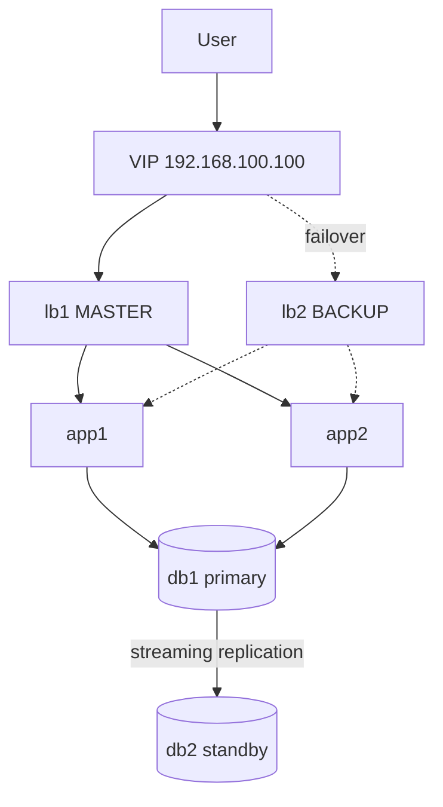

# Highly Available 3-Tier Web Application

A load-balanced Flask application with PostgreSQL replication, built on Rocky Linux 9 and automated with Ansible.

## Features
- Two HAProxy load balancers sharing a virtual IP (keepalived / VRRP)
- Two application servers (Nginx → Gunicorn → Flask)
- PostgreSQL 16 primary with an asynchronous streaming standby
- Full application stack configured by Ansible roles
- Rolling updates of the app tier, one server at a time
- SELinux enforcing and firewalld enabled
- Secrets encrypted with Ansible Vault

## Architecture



## Tech Stack

| Layer | Technology |
|---|---|
| Operating system | Rocky Linux 9 |
| Load balancing | HAProxy, keepalived |
| Web / application | Nginx, Gunicorn, Flask |
| Database | PostgreSQL 16 |
| Automation | Ansible |
| Virtualization | VMware Workstation Pro |

## Lab Environment

Network: VMware NAT `192.168.100.0/24`, gateway `192.168.100.2`

| Host | Role | vCPU | RAM | IP |
|---|---|---|---|---|
| control | Ansible control node | 2 | 2 GB | 192.168.100.10 |
| lb1 | Load balancer (master) | 1 | 1 GB | 192.168.100.11 |
| lb2 | Load balancer (backup) | 1 | 1 GB | 192.168.100.12 |
| app1 | Application server | 1 | 1 GB | 192.168.100.21 |
| app2 | Application server | 1 | 1 GB | 192.168.100.22 |
| db1 | Database primary | 1 | 1.5 GB | 192.168.100.31 |
| db2 | Database standby | 1 | 1.5 GB | 192.168.100.32 |

Virtual IP: `192.168.100.100`

## Project Structure

```
ha-3tier-app/
├── ansible.cfg
├── requirements.yml
├── site.yml
├── rolling-update.yml
├── failover-db.yml
├── inventory/hosts.ini
├── group_vars/all/
│   ├── vars.yml
│   └── vault.yml
├── roles/
│   ├── common/
│   ├── db/
│   ├── app/
│   └── loadbalancer/
└── docs/
    └── failover-demo.gif
```

## Prerequisites
- Seven Rocky Linux 9 (Minimal Install) VMs with the static IPs above
- A `devops` user with passwordless sudo on the managed nodes (lab only)
- `ansible-core` and `git` on the control node
- SSH key access from the control node to all six managed nodes
- Internet access on all VMs

## Setup

1. Clone the repository:
   ```bash
   git clone https://github.com/YOUR_USERNAME/ha-3tier-app.git
   cd ha-3tier-app
   ```

2. Install the Ansible collections:
   ```bash
   ansible-galaxy collection install -r requirements.yml
   ```

3. Create your own secrets. The included `vault.yml` is encrypted with the author's password, so replace it:
   ```bash
   echo 'your-vault-password' > .vault_pass
   chmod 600 .vault_pass
   rm group_vars/all/vault.yml
   ansible-vault create group_vars/all/vault.yml
   ```
   Add these variables (the VRRP password is limited to 8 characters):
   ```yaml
   vault_db_password: change_me
   vault_repl_password: change_me
   vault_vrrp_password: changeme
   ```

4. Check connectivity and deploy:
   ```bash
   ansible all -m ping
   ansible-playbook site.yml
   ```

5. Open `http://192.168.100.100` in a browser.

## Endpoints

| Path | Purpose |
|---|---|
| `/` | Records a visit; shows the serving host and version |
| `/health` | Application health check used by HAProxy |
| `/health/db` | Database connectivity check |

## Rolling Update

Change `app_version` in `group_vars/all/vars.yml`, then run:
```bash
ansible-playbook rolling-update.yml
```
For each app server, the playbook drains it from both load balancers, updates it, verifies its health and version, then re-enables it. A failure stops the run.

## Failover Behaviour

| Failure | Behaviour |
|---|---|
| App server down | HAProxy removes it after failed health checks |
| Load balancer down | Virtual IP moves to the other load balancer |
| HAProxy service down | Virtual IP moves to the other load balancer |
| Database primary down | Manual promotion required |

Promote the standby:
```bash
ansible-playbook failover-db.yml
```

> **Warning:** Do not let the old primary rejoin as it is. It would accept writes as a second primary (split-brain). Fence it and rebuild it as a standby. Do not run `site.yml` after a promotion until the old primary is rebuilt and the inventory roles are updated.

## Limitations
- Database failover is manual
- Replication is asynchronous, so recent transactions can be lost on failover
- All VMs run on one physical machine
- No HTTPS, monitoring or automated backups

## Future Improvements
- Automatic database failover with Patroni and etcd
- TLS termination at HAProxy
- Monitoring with Prometheus and Grafana
- Scheduled database backups
- CI checks with GitHub Actions and ansible-lint

## Author
**Ashok Kumar V S** · [GitHub](https://github.com/As-h-ok)
